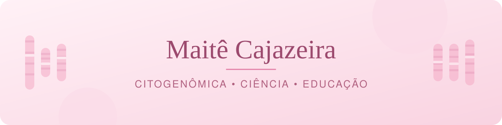

  

  
  

---

### 🌸 Sobre mim

- 🔬 Pesquisadora no **Laboratório de Citogenômica do Câncer** da UFC
- 🧬 Pós-graduanda em **Biologia Molecular e Genética Humana**
- 🥗 Nutricionista e criadora de conteúdo sobre ciência e saúde
- 📍 Fortaleza, Ceará, Brasil

---

### 💗 Projeto em destaque

<table>
  <tr>
    <td>
      <h4>🧬 Monta Cariótipo</h4>
      
O primeiro simulador completo de citogenética do Brasil. Aprenda de forma acessível, criativa e imersiva: caça-metáfase, montagem de cariótipo e conteúdos de citogenômica.

      
    </td>
  </tr>
</table>

---

### 🎨 Criatividade & Design

Além da ciência, eu crio: edito vídeos, desenvolvo artes e transformo conteúdo técnico em algo bonito, leve e fácil de entender. Aqui ficam algumas das minhas criações.

#### 🎬 Edição de vídeo

✨ Galeria em construção — novas criações chegando em breve

<!-- GALERIA DE VÍDEOS (cada célula = 1 criação; a imagem é um GIF de prévia ou capa, e o link leva ao vídeo completo)
<table>
<tr>
<td align="center" width="33%">

 <b>TÍTULO</b> Descrição curta · Ferramenta
</td>
</tr>
</table>
-->

#### 🖼️ Design & imagem

✨ Galeria em construção — novas criações chegando em breve

<!-- GALERIA DE IMAGENS (cada célula = 1 criação)
<table>
<tr>
<td align="center" width="33%">

 <b>TÍTULO</b> Descrição curta · Ferramenta
</td>
</tr>
</table>
-->

---

### 🎀 Áreas de interesse

---

Feito com carinho, ciência e um toque de rosa 🌷

